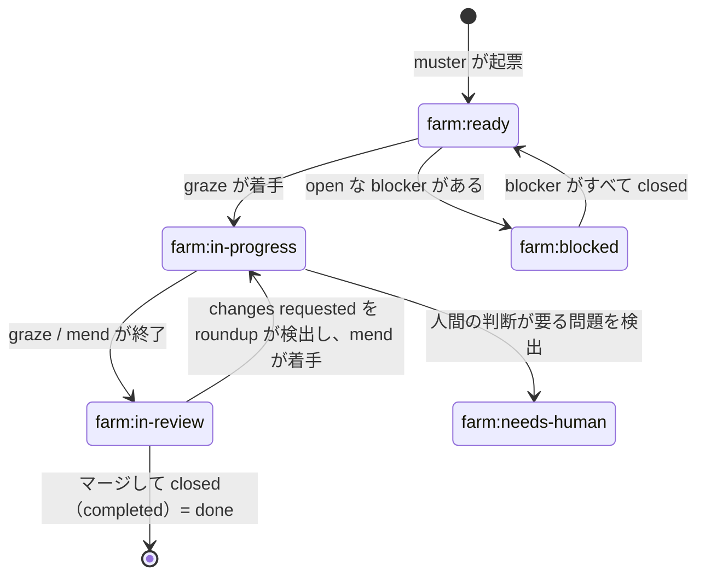

# common-sense

- farm の各スキルが共通で参照する規約の定義。
- このスキル自身は何も実行しない。規約を読んで、呼び出し元のスキルが従う。

## 状態モデル

- ステータスのラベルは Issue にのみ付け、PR には付けない。
- ステータスのラベルは常に1つまで。遷移時は新しいラベルを付けて古いラベルを外す（付け替え）。
- ラベルの種類と意味は、labels.json に定義している。
- done はラベルを持たない。Issue が closed（completed）であることから導出する。

## 状態遷移



- ready に遷移するのは muster だけ。
- needs-human への遷移では、理由をコメントに書く。
- changes requested は、PR の reviewDecision から roundup が検出する。
- in-progress の Issue は、shepherd が触らない。

## 依存

- GitHub のネイティブな依存関係（blocked by）を正本とする。
- Issue 本文には、依存を書かない。
- blocked は、open な blocker の有無から導出する。
- 導出した結果に合わせて、blocked ラベルを同期する。

## Issue 形式

- 節構成は、テンプレートファイルに従う。
  - templates/task.md: 通常の Issue。
  - templates/bug.md: バグの Issue。
- 種別は、GitHub の issue type で表す。
- 完了条件は、チェックボックスで3つまでにする。
- 設計は基本書かない。
- プロジェクトの成長に関わる判断は、背景・文脈に記録する。

## Issue の規模

- 1 Issue = 1セッション = 1 PR。
- 目的は1つにする。
- 単独で完了できること。

## コメント規約

- コメントは、ラベルで表現できない事態のときだけ書く。
- 書き先は問題の種類で決める。
  - 要件の問題は、Issue に書く。
  - 実装の問題は、PR に書く。
- エージェントが書くコメントの先頭には、farm のコメントであることが分かるマーカーを入れる。
  - マーカーの形式は、次の HTML コメント。

    ```
    <!-- farm:comment -->
    ```

## 経緯の置き場所

- コード（コメントを含む）に、経緯や以前の実装の打ち消しを書かない。
- コードは現在の仕様だけを表す。
- 経緯と判断の記録は Issue に置き、Issue を ADR として扱う。
- 経緯をたどるときは、git の変更履歴から PR と Issue をたどる。
